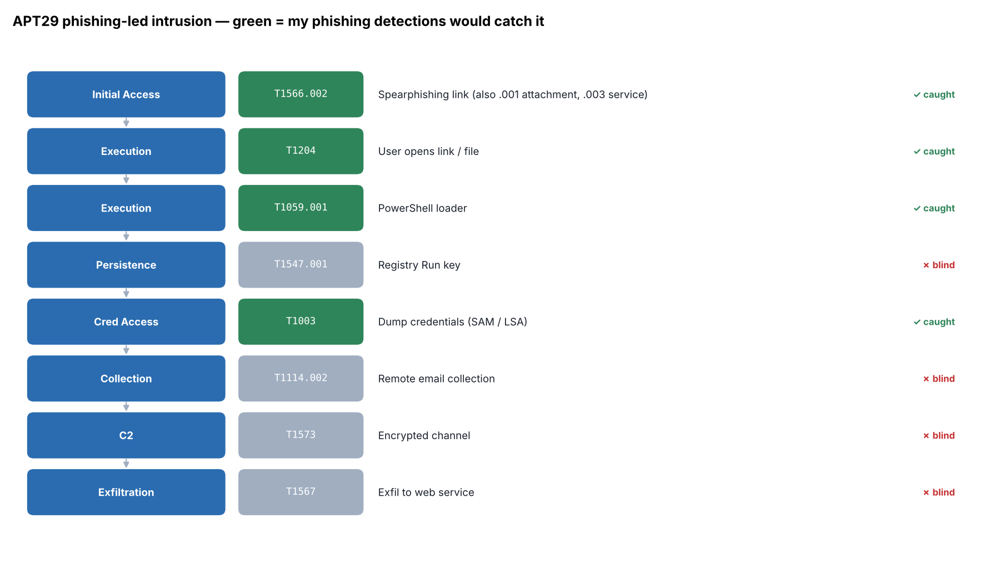
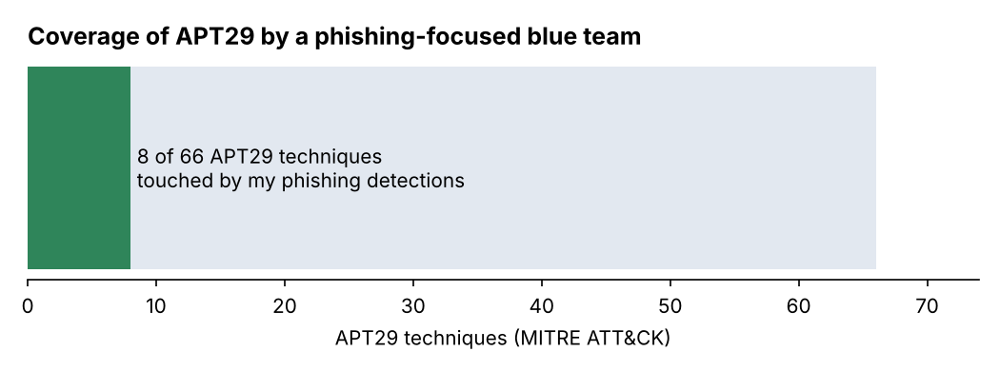

# Week 10: Learning APT Techniques

**Project topic:** Phishing campaigns targeting Kazakhstan users and brands
**Syllabus tasks (3.3, Week 10):**
1. Analyze the TTPs of APT29 or APT41.
2. Map the observed techniques to the MITRE ATT&CK framework.

Sources: Mandiant APT1 report, CrowdStrike Global Threat Report, MITRE ATT&CK.

---

## 1. Why APT29

I chose **APT29** because it is the most **phishing-led APT (Advanced Persistent Threat — a well-resourced,
usually state-sponsored group running long-term intrusions)**, so it connects directly to my topic. APT29
is attributed to the Russian SVR and is tracked under many aliases: **Cozy Bear, The Dukes, NOBELIUM,
Midnight Blizzard, UNC2452** (behind the 2020 SolarWinds supply-chain compromise).

## 2. APT29 TTPs mapped to ATT&CK

I did not hand-copy techniques — I extracted them **programmatically from the official MITRE ATT&CK STIX
data** (the machine-readable ATT&CK dataset), so the mapping is authoritative. APT29 has **66 techniques**
across all tactics. Full list: [`data/apt29_ttps.json`](data/apt29_ttps.json). Navigator layer:
[`navigator/apt29_layer.json`](navigator/apt29_layer.json).

**The phishing-relevant TTPs (the part that overlaps my project):**

| Tactic | Technique | ID |
|--------|-----------|-----|
| Initial Access | Spearphishing **Attachment / Link / via Service** (all three) | T1566.001/.002/.003 |
| Initial Access | Valid Accounts, Trusted Relationship, Exploit Public-Facing App | T1078, T1199, T1190 |
| Execution | User Execution (link + file), PowerShell | T1204.001/.002, T1059.001 |
| Credential Access | OS Credential Dumping, Steal App Access Token, MFA fatigue | T1003, T1528, T1621 |
| Persistence | Registry Run Keys, Scheduled Task, Cloud/Web Shell | T1547.001, T1053.005, T1505.003 |
| C2 / Exfil | Encrypted Channel, Domain Fronting, Multi-hop Proxy | T1573, T1090.004, T1090.003 |

**Observation:** APT29 uses **all three** phishing sub-techniques — the same initial access as my criminal
actor — but then goes far deeper (cloud, MFA-fatigue, supply chain) than Classiscam ever does.

## 3. APT (espionage) vs Classiscam (crime) — my comparison

This is the original part: I compare the state-sponsored APT I analysed with the criminal actor my whole
project targets. Full table: [`data/comparison.csv`](data/comparison.csv).

| | APT29 (Cozy Bear) | Classiscam (my actor) |
|---|---|---|
| Type | State-sponsored APT, espionage | Financially motivated crime (PhaaS) |
| Motivation | Intelligence | Money (card data, resale) |
| Initial access | Phishing **+ valid accounts + supply chain** | Phishing link via OLX/messenger |
| Sophistication | Very high (custom malware, 0-days, cloud) | Low–medium (rented kits, Telegram) |
| Persistence | Registry, tasks, cloud, web shells | **None** on victim (uses stolen card) |
| Targets | Governments, tech vendors | Ordinary marketplace users |

**Both start with the same door — spearphishing — but behind it they are completely different threats.**

## 4. What my phishing detections would catch against APT29

Because APT29's intrusion also *starts* with phishing, I checked how far my project's detections (Weeks
3/5/7/9) would get against it.





- **My detections touch 8 of APT29's 66 techniques** — exactly the phishing + user-execution + PowerShell +
  credential-dump chain (`navigator/overlap_layer.json`, score 2).
- **Where I'd catch them:** the entry — spearphishing (T1566.001/.002/.003), user execution (T1204),
  PowerShell loader (T1059.001), and the credential dump (T1003), using my Sigma rule, my hunts and my CAR
  analytics from Week 9.
- **Where I'd be blind:** everything APT-specific — cloud accounts, MFA-fatigue, domain fronting, encrypted
  C2, remote email collection, the SolarWinds-style supply chain. A phishing-focused blue team stops a
  commodity criminal, but only *delays* a determined APT.

**Conclusion:** the same front door (phishing) means my work is a real first line of defence even against a
nation-state group — but defence in depth (identity, cloud, EDR, network) is required beyond initial access.
This is the honest limit of a phishing-scoped project, and a natural direction for future work.

## 5. Run it

```bash
python3 scripts/build.py   # layers, comparison.csv, diagrams (from the STIX-derived TTPs)
```

## Sources
- MITRE ATT&CK APT29 (G0016): https://attack.mitre.org/groups/G0016/
- ATT&CK STIX data: https://github.com/mitre-attack/attack-stix-data
- CISA on APT29 / SolarWinds: https://www.cisa.gov/news-events/cybersecurity-advisories
- Mandiant APT1 report (historical reference for APT analysis method)
