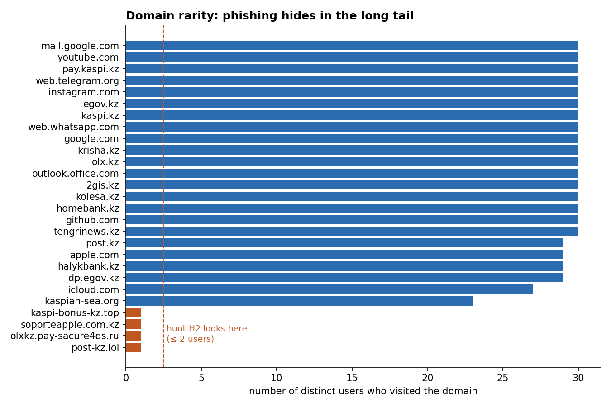
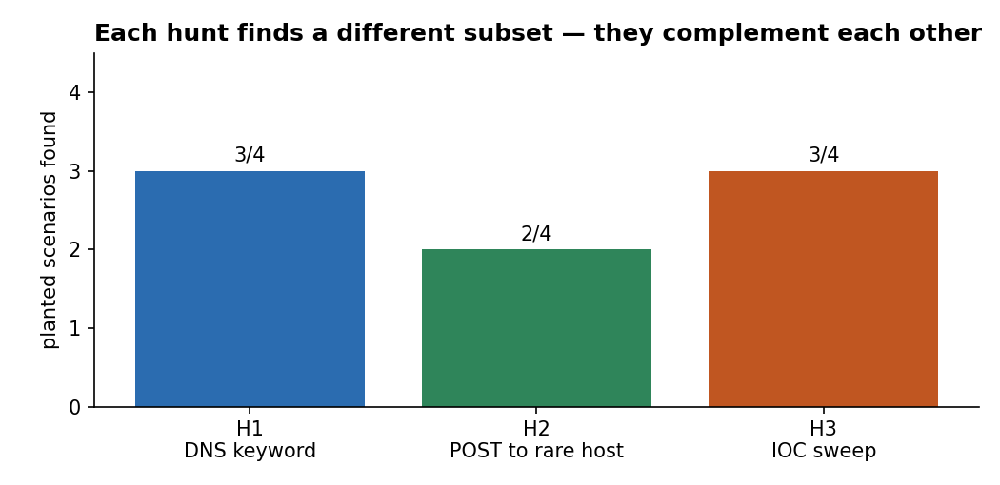
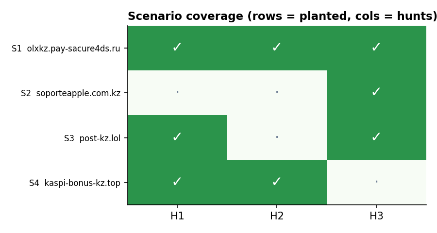

# Week 5: Threat Hunting Concept

**Project topic:** Phishing campaigns targeting Kazakhstan users and brands
**Syllabus tasks (3.3, Week 5):**
1. Build a hypothesis-driven hunting scenario (e.g. suspicious PowerShell activity).
2. Execute hunt queries in Splunk or ELK.

Lecture sources: SANS Threat Hunting Summit; P. Smith, *Practical Threat Hunting*; Microsoft Threat Hunting Guide.

The syllabus example is PowerShell, but my project is about phishing, so I hunt for the
phishing equivalent: **users who reached a phishing page that impersonates a Kazakh brand.**
I use the IOCs and the Sigma logic from Weeks 2–3 as the starting point.

---

## 1. Hunting models and where this fits

| Model | Starting point | My hunt |
|-------|----------------|---------|
| **Intel-driven** | A list of known-bad indicators | **H3**: sweep DNS logs against my Week 3 IOCs |
| **Hypothesis-driven** | An idea about attacker behaviour | **H1, H2**: look for the *behaviour*, not a fixed list |

Hypothesis-driven hunting matters because phishing domains are cheap and change daily
(Pyramid of Pain, Week 1). An intel list is always a few days behind, so I also hunt for
the *pattern*: a brand keyword in a domain, and a form submitted to a domain almost nobody visits.

## 2. The lab data

There are no real DNS/proxy logs from the university, so I generated a realistic lab dataset:
**30 users, 7 days, ~6,000 DNS and ~12,000 proxy events** ([`scripts/generate_lab_logs.py`](scripts/generate_lab_logs.py)).
The background is normal traffic (banks, eGov, social media). Four scenarios are planted; the
hunter is not told which — they live in [`data/ground_truth.json`](data/ground_truth.json) only for scoring.

| ID | User | Domain | What happened |
|----|------|--------|---------------|
| S1 | user07 | `olxkz[.]pay-sacure4ds[.]ru` | Opened a fake OLX delivery link and **submitted** the payment form (Week 2 IOC) |
| S2 | user19 | `soporteapple[.]com[.]kz` | Opened an Apple-ID lure (kit cluster C01), **did not** submit |
| S3 | user23 | `post-kz[.]lol` | Kazpost lure, **blocked** by the proxy (on the Week 3 blocklist) |
| S4 | user11 | `kaspi-bonus-kz[.]top` | **NEW** domain, not in any feed: fake Kaspi bonus, credentials submitted |

The logs are newline-delimited JSON, ready for **Splunk** (Add Data → Upload) or **Kibana** (Upload a file).

## 3. The three hunts

Run with DuckDB (SQL) via [`scripts/hunt.py`](scripts/hunt.py). The same logic is written for
**Splunk** ([`queries/splunk.spl`](queries/splunk.spl)) and **Elastic** ([`queries/elastic.kql`](queries/elastic.kql)).

```bash
pip install duckdb pandas matplotlib tabulate
python3 scripts/generate_lab_logs.py
python3 scripts/hunt.py          # -> results/*.csv, results/summary.md
python3 scripts/make_charts.py   # -> images/*.png
```

### H1 — hypothesis-driven, DNS
> **Hypothesis:** if a user is phished with a KZ-brand lure, a DNS query will contain a brand keyword
> (kaspi, halyk, egov, kazpost, olx) but will not be an official domain.

This is the same logic as my Week 3 Sigma rule `dns_kz_brand_lookalike` (v3), applied to logs.

### H2 — hypothesis-driven, proxy
> **Hypothesis:** a phishing victim submits a form (**POST**) to a domain that almost nobody in the
> organisation visits (**≤ 2 users**) and that is not on the allowlist.

This needs no IOC list at all, so it catches **unknown** domains.



### H3 — intel-driven, DNS
> Sweep every DNS query against my Week 3 IOC list (`normalized_iocs.csv`), join on the domain.

## 4. Results





| Hunt | Hits | True positives | False positives | Found |
|------|------|----------------|-----------------|-------|
| H1 (DNS keyword) | 3 | 3 | 0 | S1, S3, S4 |
| H2 (POST to rare host) | 2 | 2 | 0 | S1, S4 |
| H3 (IOC sweep) | 3 | 3 | 0 | S1, S2, S3 |

**The key finding — the hunts complement each other:**
- **H3 alone misses S4** (`kaspi-bonus-kz.top`) because it is a new domain, not in any feed.
- **H1 and H2 catch S4** because they look for the *behaviour*, not a known indicator. This is exactly why hypothesis-driven hunting is needed.
- **H3 catches S2** (`soporteapple.com.kz`), which H1 misses because "apple" is not a KZ-brand keyword, and H2 misses because the user only did a GET (no form submitted).
- `kaspian-sea.org` (benign, contains "kaspi") was **not** flagged — the Sigma FP filter from Week 3 works on logs too.

## 5. Triage

`hunt.py` also builds a triage list (worst first), turning raw hits into actions:

| User | Domain | Found by | Severity | Next step |
|------|--------|----------|----------|-----------|
| user07 | `olxkz[.]pay-sacure4ds[.]ru` | H1+H2+H3 | **HIGH** (data submitted) | Reset passwords / block card, isolate, interview |
| user11 | `kaspi-bonus-kz[.]top` | H1+H2 | **HIGH** (data submitted) | Reset passwords / block card, isolate, interview |
| user19 | `soporteapple[.]com[.]kz` | H3 | MEDIUM (visited only) | Confirm nothing entered, awareness note |
| user23 | `post-kz[.]lol` | H1+H3 | LOW (blocked) | No action, blocklist worked |

Severity = HIGH when a POST (H2) is seen, LOW when the proxy blocked it.

## 6. Conclusions

1. A hypothesis beats a plain IOC list for fast-changing phishing: H1/H2 caught a domain no feed knew yet.
2. Intel and hypothesis hunts should run **together** — each covers the other's blind spot.
3. The Week 3 Sigma logic transfers directly to a hunt, and the FP filter keeps it clean on real traffic.
4. A hunt is only useful if it ends in **triage and action**, not just a list of hits.

## 7. Feeding results back (Week 5 → detection)

The new domain `kaspi-bonus-kz.top` found by the hunt should become a new indicator: add it to the
MISP event (Week 3) and it will be blocked next time. This closes the loop: hunt → new IOC → detection.
