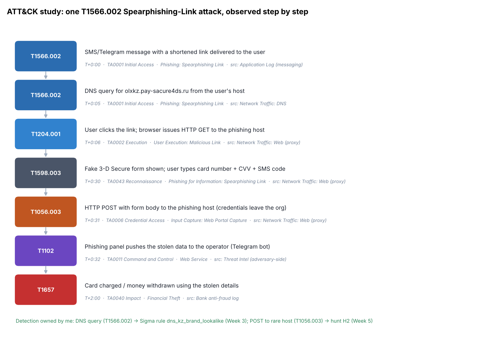

# Week 6: ATT&CK Framework

**Project topic:** Phishing campaigns targeting Kazakhstan users and brands
**Syllabus tasks (3.3, Week 6):**
1. Study one specific technique (the example is T1059; I study **T1566.002**, the core of my topic).
2. Simulate an attack and map results to ATT&CK tactics and techniques.

Source: attack.mitre.org. Recommended reading: MITRE ATT&CK Navigator documentation.

> **Safety note.** Nothing here attacks anything. The "simulation" is a paper/purple-team
> exercise: a script emits the *telemetry a defender would see* and tags each event with its
> ATT&CK technique. No phishing page is built, hosted, or sent.

---

## 1. The technique I study: T1566.002 — Phishing: Spearphishing Link

| Field | Value |
|-------|-------|
| ID | **T1566.002** (sub-technique of T1566 Phishing) |
| Tactic | TA0001 **Initial Access** |
| Description | Adversaries send a message with a link to a credential-harvesting or malware page. Unlike Spearphishing Attachment (T1566.001), the malicious content is reached by clicking a link. |
| Platforms | Linux, macOS, Windows, SaaS, Office 365, Identity Provider |
| Data sources | **Application Log** (messaging), **Network Traffic** (DNS, web) |
| Detection (ATT&CK) | Inspect URLs in messages; monitor DNS/proxy for newly-seen or lookalike domains; user-reported phishing |
| My relevance | This is exactly the OLX/Kaspi/Kazpost scam from Weeks 2–4 — the lure is an SMS/Telegram **link**, not an attachment |

### Tactics / Techniques / Procedures for my topic
- **Tactic** — what the adversary wants: Initial Access (get the victim to the page).
- **Technique** — how: T1566.002 Spearphishing Link.
- **Procedure** — the concrete way my actor does it: a Classiscam worker poses as a buyer on
  OLX.kz, moves the victim to WhatsApp/Telegram, and sends a link to `olxkz[.]pay-sacure4ds[.]ru`
  (a real indicator from my Week 2 data).

### Neighbouring techniques (the sub-technique family)
T1566.001 Attachment · **T1566.002 Link** · T1566.003 via Service · T1566.004 Voice. My project
is almost entirely **.002 and .003**; Week 7 looks at the **.001 (attachment)** follow-on.

## 2. Simulation: one link-click, mapped to ATT&CK

`scripts/simulate_click.py` emits the ordered telemetry of a single victim (`user07`) and tags
each event. This answers "simulate an attack and map results to ATT&CK" without touching anything live.



| Time | Observed event | Data source | Technique | Tactic |
|------|----------------|-------------|-----------|--------|
| T+0:00 | Link delivered via SMS/Telegram | Application Log | T1566.002 | Initial Access |
| T+0:05 | DNS query for the phishing host | Network: DNS | T1566.002 | Initial Access |
| T+0:06 | Browser GET to the phishing host | Network: Web | T1204.001 User Execution | Execution |
| T+0:30 | Fake 3-D Secure form, user types card data | Network: Web | T1598.003 Phishing for Information | Reconnaissance |
| T+0:31 | **POST** with the form body (data leaves) | Network: Web | T1056.003 Input Capture: Web Portal | Credential Access |
| T+0:32 | Panel pushes data to the operator | (adversary-side) | T1102 Web Service | Command & Control |
| T+2:00 | Card charged | Bank anti-fraud log | T1657 Financial Theft | Impact |

**6 techniques across 6 tactics.** The ATT&CK Navigator layer is in
[`navigator/t1566_layer.json`](navigator/t1566_layer.json) (import via *Open Existing Layer*).

## 3. Where my own detection sits on this chain

The point of mapping is to see **what I can already catch** and where the gaps are:

| Step | Technique | My existing detection |
|------|-----------|-----------------------|
| DNS query | T1566.002 | **Sigma `dns_kz_brand_lookalike`** (Week 3) + hunt **H1** (Week 5) |
| POST to rare host | T1056.003 | Hunt **H2** (Week 5) |
| Known host | T1566.002 | **MISP** blocklist / IOC sweep **H3** (Week 5) |
| Card charged | T1657 | Out of my scope — bank anti-fraud |

So my project covers Initial Access → Credential Access well, but has **no visibility** of the
Impact stage (that belongs to the bank). This gap is the motivation for Week 8's emulation plan,
which checks each stage against a detection.

## 4. Run it

```bash
python3 scripts/simulate_click.py   # -> data/attack_timeline.csv + .json, navigator layer
python3 scripts/make_diagram.py     # -> images/attack_timeline.png
```

## Sources
- MITRE ATT&CK T1566.002: https://attack.mitre.org/techniques/T1566/002/
- MITRE ATT&CK Navigator: https://mitre-attack.github.io/attack-navigator/
