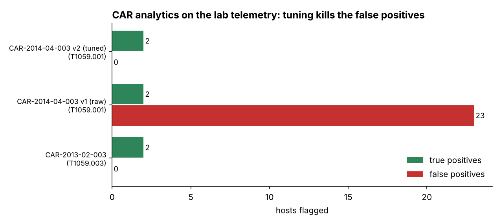

# Week 7: Using MITRE CAR (Cyber Analytics Repository)

**Project topic:** Phishing campaigns targeting Kazakhstan users and brands
**Syllabus tasks (3.3, Week 7):**
1. Select an analytic from CAR and implement it in a SIEM.
2. Map the analytic to related ATT&CK techniques.

Source: car.mitre.org. Recommended reading: MITRE CAR documentation.

> **Safety note.** The telemetry here is synthetic lab data (`data/sysmon_proc.json`). No process
> is executed; the "malicious" command lines are descriptive strings, not runnable payloads.

---

## 1. Analytics vs detections — and why CAR fits here

An **analytic** is a reusable, vendor-neutral idea for spotting a behaviour (CAR describes it in
pseudocode + data model). A **detection** is that idea implemented in one SIEM's query language.
CAR analytics are mostly **host/process** based, which is the blind spot of my project: Weeks 2–6
covered the network side (DNS, proxy) of phishing. CAR lets me cover the **follow-on** on the endpoint.

**The link to my topic:** phishing has an *attachment* variant (T1566.001). When a user opens a
malicious document from a phishing email, Office or the PDF reader spawns a shell. CAR-2013-02-003's
own description says: *"if Adobe Reader or Outlook launches a command shell, this may suggest that a
malicious document has been loaded."* That is precisely the phishing follow-on I want to catch.

## 2. The analytics I selected

| CAR ID | Title | ATT&CK | Idea |
|--------|-------|--------|------|
| **CAR-2013-02-003** | Processes Spawning cmd.exe | **T1059 / T1059.003** (TA0002 Execution) | An Office/mail/PDF app spawning `cmd.exe` = a loaded malicious document |
| **CAR-2014-04-003** | PowerShell Execution | **T1059.001** | `powershell.exe` not launched interactively (parent ≠ explorer) |

Both sit under **T1059 Command and Scripting Interpreter**, the natural next step after T1566.001.

## 3. Implementation in a SIEM

Implemented in DuckDB as the "SIEM" ([`scripts/run_car.py`](scripts/run_car.py)), and written out for
**Splunk** ([`queries/splunk.spl`](queries/splunk.spl)) and **Elastic ES|QL** ([`queries/elastic.esql`](queries/elastic.esql)).
The lab telemetry is Sysmon EventID 1 style (25 hosts, 5 days, ~6,600 events) with two planted
phishing-attachment chains: `outlook.exe → cmd.exe → powershell.exe` and `winword.exe → …`.

```bash
pip install duckdb pandas matplotlib tabulate
python3 scripts/generate_proc_logs.py   # lab Sysmon telemetry + ground truth
python3 scripts/run_car.py              # -> results/*.csv, summary.md
python3 scripts/make_charts.py          # -> images/car_precision.png
```

## 4. Results and the tuning lesson



| Analytic | ATT&CK | Hits | True positives | False positives |
|----------|--------|------|----------------|-----------------|
| CAR-2013-02-003 | T1059.003 | 2 | 2 | 0 |
| CAR-2014-04-003 **v1** (literal: parent ≠ explorer) | T1059.001 | 161 | 2 | 23 |
| CAR-2014-04-003 **v2** (tuned: + `-enc`/`hidden`) | T1059.001 | 2 | 2 | 0 |

- **CAR-2013-02-003 is precise out of the box** here: no benign app in the lab spawns cmd from Office,
  so the 2 hits are exactly the planted attachment chains.
- **CAR-2014-04-003 v1 is unusable** in this org: admins and scripts run `cmd → powershell` all day,
  so the literal analytic fires 161 times on 25 hosts (23 of them benign). Adding the real malicious
  discriminator from CAR's own examples — **encoded / hidden-window PowerShell** — drops it to a clean
  2/0. This is the same tuning lesson as my Week 3 Sigma rule and Week 5 hunts: *an analytic must be
  tuned to the environment before it is a detection.*

## 5. Mapping back to ATT&CK and to my chain

```
Phishing email (T1566.001)  →  user opens doc (T1204.002)
     →  outlook.exe spawns cmd.exe   .............  CAR-2013-02-003  →  T1059.003
          →  cmd.exe spawns encoded powershell  ..  CAR-2014-04-003  →  T1059.001
```

This extends my ATT&CK coverage from the network side (Weeks 2–6) onto the **endpoint**, and it is
the detection half of the emulation plan in Week 8.

## Sources
- MITRE CAR-2013-02-003: https://car.mitre.org/analytics/CAR-2013-02-003/
- MITRE CAR-2014-04-003: https://car.mitre.org/analytics/CAR-2014-04-003/
- ATT&CK T1059: https://attack.mitre.org/techniques/T1059/
