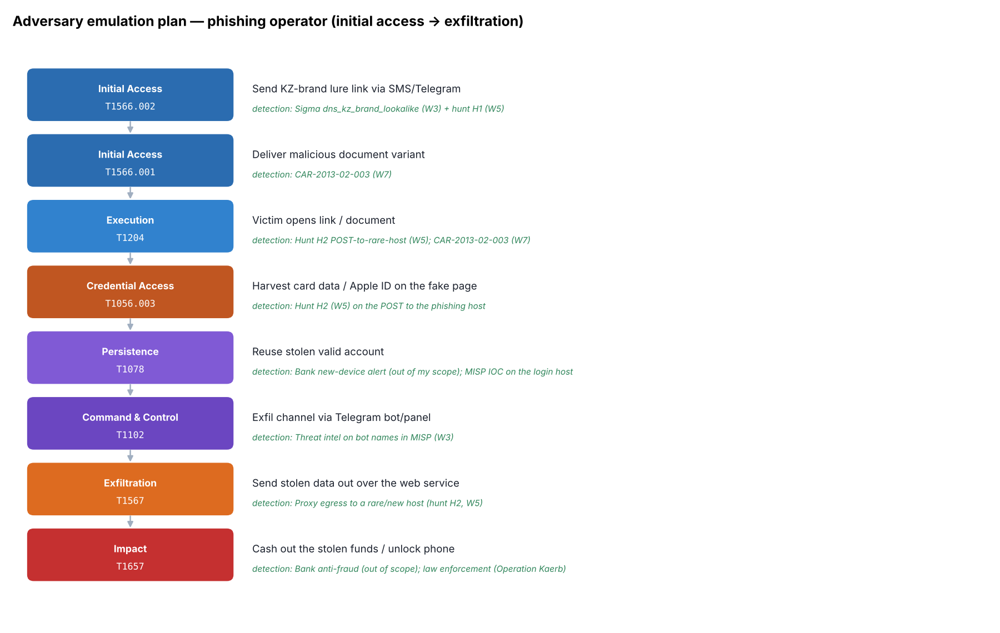

# Week 8: Creating a Plan to Emulate an Attacker's Action

**Project topic:** Phishing campaigns targeting Kazakhstan users and brands
**Syllabus tasks (3.3, Week 8):**
1. Develop a simple adversary emulation plan (initial access → persistence → data exfiltration).
2. Document the plan using ATT&CK techniques.

Sources: MITRE Engenuity, Red Teaming resources. Recommended reading: MITRE CALDERA documentation.

> **Safety note.** This is a **plan** and a **detection test**, not attack tooling. The CALDERA
> abilities in [`caldera/`](caldera/) are **inert**: each one only `echo`es a marker line so a
> defender can confirm the matching detection fires. Nothing here sends phishing, steals
> credentials, or exfiltrates data. No working phishing kit or payload is included.

---

## 1. What an emulation plan is and why I build one

An adversary emulation plan reproduces a *specific* threat actor's known behaviour, step by step,
so a defender can test whether their detections actually fire. I emulate the **Classiscam-style
phishing operator** from my Weeks 2–4 analysis, and I use the plan to **audit my own coverage**:
every step should map to a detection I built in Weeks 3, 5 or 7.

## 2. The plan: initial access → persistence → exfiltration



Full table with procedures, detections and data sources: [`emulation-plan.md`](emulation-plan.md).

| # | Phase | ATT&CK | Step | My detection |
|---|-------|--------|------|--------------|
| 1 | Initial Access | T1566.002 | Send KZ-brand lure link | Sigma `dns_kz_brand_lookalike` (W3) + hunt H1 (W5) |
| 2 | Initial Access | T1566.001 | Malicious document variant | CAR-2013-02-003 (W7) |
| 3 | Execution | T1204 | Victim opens link / document | Hunt H2 (W5); CAR-2013-02-003 (W7) |
| 4 | Credential Access | T1056.003 | Harvest card / Apple ID on fake page | Hunt H2 (W5) |
| 5 | Persistence | T1078 | Reuse stolen valid account | Bank new-device (out of scope); MISP IOC |
| 6 | Command & Control | T1102 | Telegram bot/panel channel | MISP threat intel (W3) |
| 7 | Exfiltration | T1567 | Stolen data leaves over web service | Proxy egress to rare host, hunt H2 (W5) |
| 8 | Impact | T1657 | Cash out / unlock phone | Bank anti-fraud (out of scope); law enforcement |

The ATT&CK Navigator layer is [`navigator/emulation_layer.json`](navigator/emulation_layer.json).

## 3. Coverage audit — the point of the exercise

- **6 of 8 steps** are covered by a detection I built myself across the project.
- The **2 gaps are both on the bank side** — new-device login (T1078) and cash-out (T1657) — which
  the organisation's network/endpoint telemetry genuinely cannot see. That is an honest scoping
  result, not a hole in my layer: it shows where I must rely on a partner (the bank) or law
  enforcement (Operation Kaerb took down the iServer Apple-ID operation in Sep 2024).
- Everything the org *can* see — DNS, proxy, process — is covered by **Sigma (W3) + hunts (W5) +
  CAR (W7)**. The plan proves my five weeks of detections chain together end to end.

## 4. Running the inert emulation (purple-team detection test)

```bash
python3 scripts/build.py        # regenerate the plan, abilities, layer, diagram
# Each ability only drops a marker log line. In a lab you would import them into CALDERA,
# run them against a test host, and confirm your SIEM detection fires on each step:
for a in caldera/*.yml; do echo "[import to CALDERA] $a"; done
```

Each [`caldera/*.yml`](caldera/) is a standard CALDERA ability (id, name, tactic, technique attack_id,
platform executors) whose command is a harmless `echo` / `Write-Output`. This is the safe,
defensive way to test detections without running real adversary actions.

## 5. Conclusion

The emulation plan closes the project's loop: **intel (W1–2) → processing + detection (W3) →
Kill Chain (W4) → hunting (W5) → ATT&CK technique study (W6) → CAR analytics (W7) → emulation (W8)**.
Mapping the whole attack to ATT&CK and then checking each step against a detection shows, concretely,
what my phishing-focused blue-team setup catches and where the bank must take over.

## Sources
- MITRE ATT&CK T1566 / T1078 / T1567 / T1657: https://attack.mitre.org
- MITRE CALDERA: https://caldera.mitre.org/
- MITRE Engenuity, Adversary Emulation Library: https://github.com/center-for-threat-informed-defense/adversary_emulation_library
