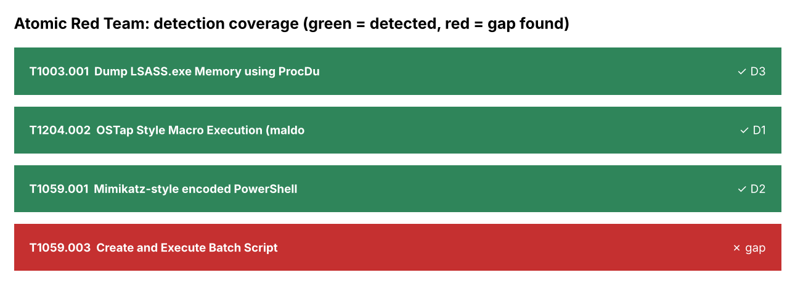

# Week 9: Atomic Red Team

**Project topic:** Phishing campaigns targeting Kazakhstan users and brands
**Syllabus tasks (3.3, Week 9):**
1. Run selected atomic tests (e.g. T1059, T1003).
2. Record and analyze the test results in a SIEM.

Sources: Red Canary Atomic Red Team GitHub repo and wiki.

> **Safety note.** Real Atomic Red Team tests run actual (benign-but-real) attacker commands —
> dumping LSASS, encoded PowerShell — and **must** run on an **isolated Windows VM with Sysmon**,
> never on a shared or production machine. I did **not** execute them here. I use the **real test
> definitions** (saved under [`atomics/`](atomics/), pulled from the Red Canary repo) as the
> specification, emit the Sysmon telemetry each test produces, record it in my SIEM, and verify my
> detections fire. The execution half of the lab is described in section 5.

---

## 1. What Atomic Red Team is

**Atomic Red Team (ART — an open library by Red Canary of small, single-technique tests, each one
mapped to an ATT&CK technique)**. Each **atomic test (one short, precise action that exercises exactly
one technique, with a known command and expected result)** lets a defender answer one question:
*"if this technique happened on my network, would my detection catch it?"*

## 2. The tests I selected

I picked four tests that match my project's phishing follow-on chain (Weeks 6–7) **and** are techniques
used by APT29 (Week 10), so the three weeks line up:

| Atomic test | ATT&CK | What the real test does (from the ART YAML) |
|-------------|--------|---------------------------------------------|
| Create and Execute Batch Script | **T1059.003** | cmd.exe runs a `.bat` script |
| Encoded PowerShell | **T1059.001** | `powershell -nop -w hidden -enc …` (hidden, base64) |
| OSTap macro (maldoc) | **T1204.002** | a Word macro spawns cmd → wscript — the phishing-attachment chain |
| Dump LSASS (ProcDump) | **T1003.001** | `procdump -ma lsass.exe` dumps credential memory |
| Dump LSASS (comsvcs.dll) | **T1003.001** | `rundll32 comsvcs.dll, MiniDump … lsass` |

The real definitions are in [`atomics/`](atomics/). T1003 (**OS Credential Dumping — stealing passwords
from memory**) is the classic "what the attacker does after the phish succeeds".

## 3. Record and analyze in the SIEM

`scripts/atomic_sim.py` emits the **Sysmon (Windows process-logging tool) EventID-1** telemetry each test
produces (same schema as Week 7), and `scripts/detect.py` records it in DuckDB (the SIEM) and runs my
detections — my two Week 7 CAR analytics plus one new rule for the LSASS dumps.

```bash
pip install duckdb pandas matplotlib tabulate
python3 scripts/atomic_sim.py   # "run" the tests -> data/atomic_telemetry.json
python3 scripts/detect.py       # record + detect -> results/scorecard.csv, summary.md
python3 scripts/make_chart.py   # -> images/atomic_coverage.png
```

## 4. Results — and the gap the test exposed



| Atomic test | ATT&CK | Detected | By rule |
|-------------|--------|----------|---------|
| OSTap macro (maldoc) | T1204.002 | ✅ | D1 = CAR-2013-02-003 |
| Encoded PowerShell | T1059.001 | ✅ | D2 = CAR-2014-04-003 |
| Dump LSASS ×2 | T1003.001 | ✅ | D3 = new LSASS rule |
| Create & Execute Batch Script | T1059.003 | ❌ | **gap** |

**3 of 4 techniques detected — and the miss is the most valuable result.** My CAR-2013-02-003 rule only
fires when **an Office app** spawns `cmd.exe`, because I tuned it for the phishing-attachment case. The
batch-script test launches `cmd.exe` from PowerShell, so it slips past. This is exactly what atomic
testing is for: **it exposed that my rule is narrow.** The fix is to add a second analytic for suspicious
`cmd.exe` script execution regardless of parent — which I note as my next detection-engineering step.

This is the same lesson as my earlier tuning work, but found the right way: by *testing* the detection
against a known-good attack simulation instead of guessing.

## 5. How to run the tests for real (the lab)

```powershell
# On an ISOLATED Windows 10 VM with Sysmon installed and a SIEM agent (Splunk/Elastic):
Install-Module -Name invoke-atomicredteam -Scope CurrentUser
Invoke-AtomicTest T1059.003 -TestNumbers 1
Invoke-AtomicTest T1003.001 -TestNumbers 1 -GetPrereqs   # downloads ProcDump first
Invoke-AtomicTest T1003.001 -TestNumbers 1
Invoke-AtomicTest T1003.001 -Cleanup
```
Then confirm the Sysmon events reached the SIEM and the detections above fired. Never run T1003 (LSASS
dump) outside an isolated lab.

## Sources
- Atomic Red Team: https://github.com/redcanaryco/atomic-red-team
- Invoke-AtomicRedTeam: https://github.com/redcanaryco/invoke-atomicredteam
- ATT&CK T1003 / T1059 / T1204: https://attack.mitre.org
